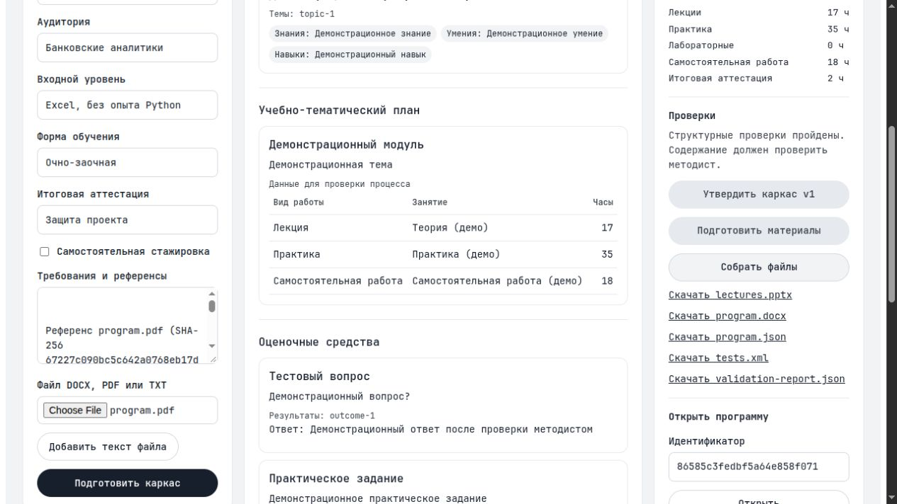

# Планерум

Рабочее место методиста для подготовки образовательных программ. Планерум связывает результаты обучения, темы, часы и оценочные материалы, хранит версии и собирает документы из одних данных.

Подготовка программы вручную по условиям кейса занимает 2–8 недель. Цель проекта — сократить составление документов и повторные проверки их согласованности. Методист проверяет и утверждает каркас, затем получает материалы для доработки и выгрузки.

**Текущий выпуск — локальный прототип для продуктового чекпойнта.** Демонстрационный режим работает без внешних ключей с заранее заданным тестовым содержанием. Адаптер Cloud.ru подготовлен; качество и скорость реальной генерации ещё не подтверждены. Доступы к API и виртуальной машине ожидаются.



## Запустить демо

Нужен Docker с Compose. Из каталога проекта:

```bash
docker compose -f compose.demo.yaml up --build
```

Откройте [127.0.0.1:8080](http://127.0.0.1:8080). Поле токена в локальном демо можно оставить пустым. Программы и очередь хранятся в памяти и исчезают при перезапуске, выгрузки сохраняются в Docker volume.

Остановка:

```bash
docker compose -f compose.demo.yaml down
```

## Сценарий показа: 3–5 минут

1. Заполните параметры курса: «Анализ банковских данных на Python», повышение квалификации, 72 часа, банковские аналитики, начальный уровень Excel, очно-заочная форма, защита проекта.
2. При необходимости загрузите DOCX, PDF с текстовым слоем или TXT. Проверьте извлечённый текст в требованиях.
3. Нажмите «Подготовить каркас». Покажите цель, карту знаний, умений и навыков, учебно-тематический план и баланс часов.
4. Утвердите каркас отдельной кнопкой и запустите подготовку материалов. До утверждения генерация и экспорт недоступны.
5. Покажите тест с ответом, практическое задание с критериями и план лекции. Нажмите «Собрать файлы»: доступны DOCX, PPTX, Moodle XML, JSON и отчёт проверок одной версии.
6. Измените ответ теста: версия увеличится, утверждение сохранится. Изменение темы отменит утверждение; в текущей версии оно также удаляет все подготовленные материалы.
7. Очистите аудиторию и снова подготовьте каркас. Появится уточняющий вопрос, старый комплект перестанет отображаться как результат нового запроса.

В демо показывается работа приложения. Пригодность учебного содержания и источников проверяет методист; статус готового комплекта означает готовность к этой проверке.

## Возможности текущего выпуска

| Инструмент | Что работает |
| --- | --- |
| Параметры и уточнения | Два типа программ, 16–500 часов; до пяти вопросов по обязательным незаполненным полям. |
| Референсы | Извлечение текста DOCX, PDF и TXT до 10 МиБ; имя и SHA-256 файла добавляются к требованиям. OCR сканов отсутствует. |
| Компетенции и план | Связи результатов с знаниями, умениями, навыками и темами; баланс часов по видам работы. |
| Утверждение | Материалы создаются после утверждения актуального каркаса. Структурная правка требует повторного утверждения. |
| Материалы | Тесты с ответами, практические задания с критериями, планы лекций и тексты слайдов. |
| Правки и версии | Ручное редактирование полей, проверка связей, отклонение устаревшей версии. |
| Очередь | Асинхронная подготовка; в рабочем режиме задания и аренда исполнителя хранятся в PostgreSQL. |
| Экспорт | JSON, DOCX, PPTX, Moodle XML с критериями и отчёт часов, покрытия и статусов источников. Публикуется только полный комплект. |

## Что предстоит завершить

- Разбор свободного запроса и сохранённый диалог уточнений.
- Календарь и отдельные проверки количественных условий: числа вопросов, минимальной практики, дневной нагрузки и состава слайдов.
- Все разделы обоих шаблонов АЦР, проверку источников и кодов трудовых функций.
- Выборочную перегенерацию зависимых материалов и сохранение завершённых частей при сбое.
- Реальные прогоны Cloud.ru, импорт в LMS, размещение на VM и методическую приёмку.

Числа 3 минуты на каркас и 20 минут на комплект 72 часа — целевые показатели кейса. Фактические скорость, стоимость и экономия труда пока не измерены. Ни один открытый запрос не объявлен прошедшим продуктовую приёмку только по результатам демо.

## Стек и устройство

Go 1.26, PostgreSQL 17, Python 3.13, обычный JavaScript и CSS. Интерфейс не требует сборщика. Docker-образ запускается без root.

| Часть | Файлы |
| --- | --- |
| Модель программы и проверки | `program.go`, `hours.go`, `report.go` |
| Утверждение и версии | `service.go`, `store.go`, `postgres.go` |
| Очередь | `jobs.go`, `postgres_jobs.go` |
| Cloud.ru и данные демо | `model.go`, `demo.go` |
| HTTP и интерфейс | `agent_api.go`, `web.go`, `static/` |
| Извлечение текста и файлы | `ingest.go`, `export.go`, `office/` |

## API

Основной маршрут — `POST /v1/agent`. Создание программы из примера:

```bash
curl --fail-with-body http://127.0.0.1:8080/v1/agent \
  -H 'Content-Type: application/json' \
  --data-binary @examples/bank72.json
```

Действия: `create`, `answer`, `status`, `approve_outline`, `generate`, `generate_async`, `job_status`, `revise`, `export`. Для изменения программы передаются `program_id` и текущий `revision`; устаревшая версия возвращает HTTP 409. Генерация или экспорт до утверждения — HTTP 422.

`POST /v1/references` принимает multipart-поле `file`. `GET /healthz` проверяет доступность процесса. При заданном `SERVICE_TOKEN` API, загрузка и скачивание защищены заголовком `Authorization: Bearer <токен>`. Подробный контракт — [OpenAPI](docs/openapi.yaml).

## Разработка и проверки

Без Docker:

```bash
python3 -m venv .venv
.venv/bin/python -m pip install -r office/requirements.txt
DEMO_MODE=1 OFFICE_PYTHON="$PWD/.venv/bin/python" go run ./cmd/server
```

Проверки:

```bash
go vet ./...
OFFICE_PYTHON="$PWD/.venv/bin/python" go test -race -count=1 ./...
.venv/bin/python -m unittest discover -s office -p 'test_*.py'
node --check static/app.js
```

Office-тесту нужны Python-зависимости. Для проверки PostgreSQL задайте `TEST_DATABASE_URL` отдельной тестовой базы; без него тест пропускается.

Для повторения HTTP-проверки запустите отдельное демо:

```bash
DEMO_MODE=1 PORT=18080 SERVICE_TOKEN=local-release-token \
  OFFICE_PYTHON="$PWD/.venv/bin/python" go run ./cmd/server
```

В другом терминале:

```bash
SERVICE_TOKEN=local-release-token python3 scripts/release_check.py \
  --demo --base http://127.0.0.1:18080 --out data/release-check
```

Флаг `--demo` подтверждает, что выбран демонстрационный сервер; режим самого сервера он не меняет. Результаты и выгрузки сохраняются в указанном каталоге и не включаются в Git.
